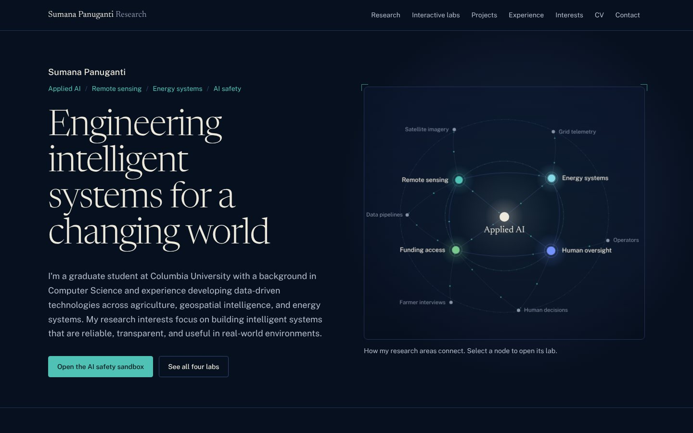
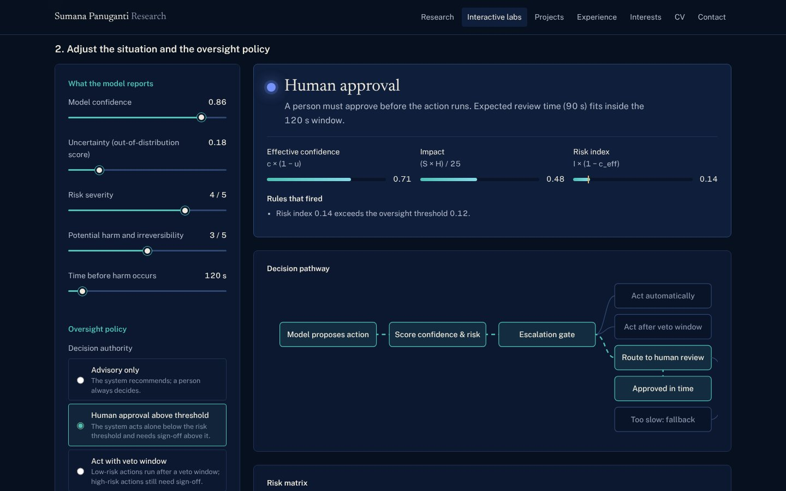
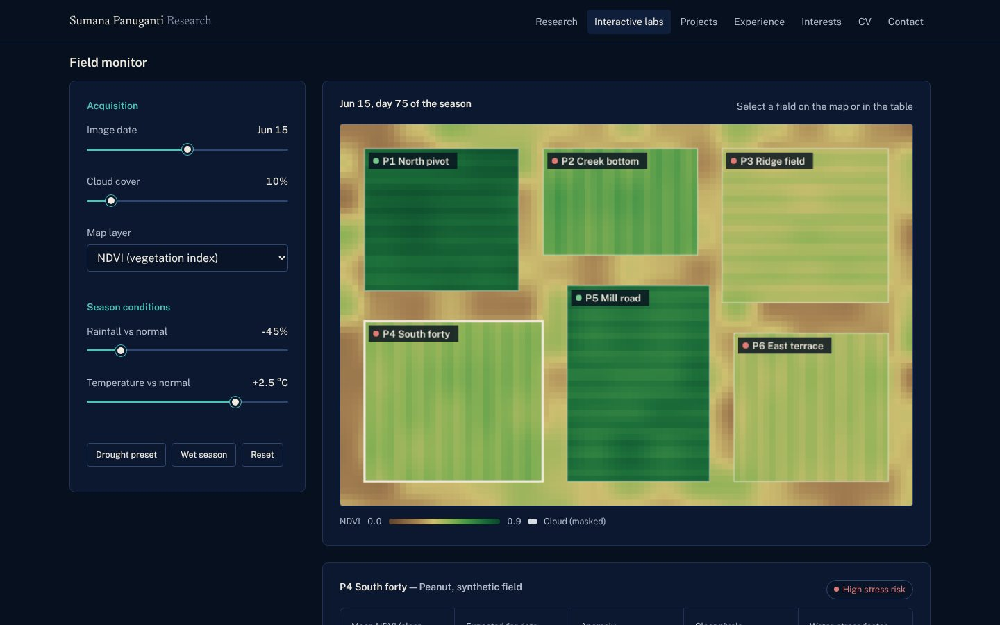
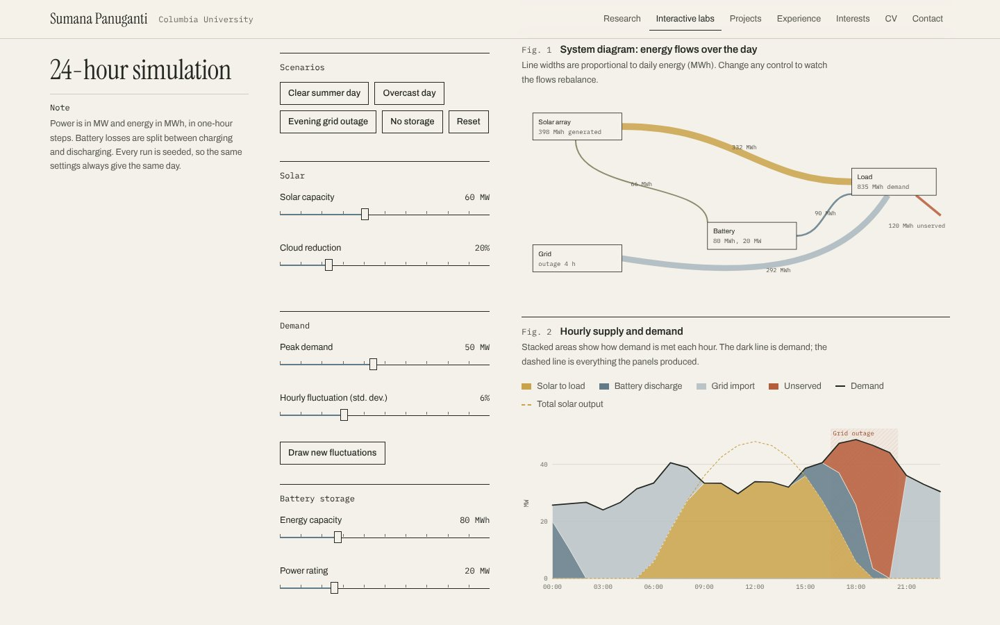
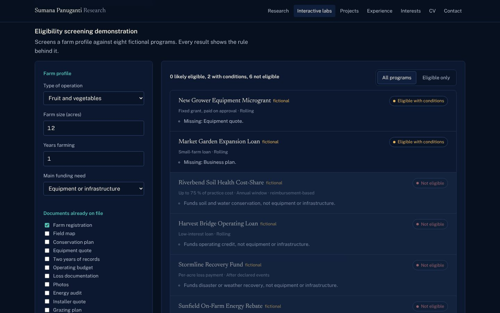

# Sumana Panuganti — Research Portfolio

An interactive research portfolio covering applied AI, remote sensing, energy systems and AI safety. It contains four working research labs, project case studies, an experience timeline and a printable CV.

**Live site:** https://sumana16713.github.io/Research-lab/



## The four labs

| Lab | Research question | Data |
|---|---|---|
| **Human oversight in critical infrastructure** (flagship) | When should an AI system act on its own in critical infrastructure, and when should human oversight be mandatory? | Hypothetical scenarios |
| **SkyAcres: geospatial crop intelligence** | Can satellite-derived indicators give early, honest warnings of crop stress, including saying when the data is too poor to tell? | Synthetic |
| **Solar, storage and grid reliability** | How much storage does a solar-heavy site need before reliability stops depending on the grid? | Simplified model |
| **AgriOne: farmer funding access** | Which barriers keep farmers from funding they are eligible for, and which can software remove? | Fictional programs and personas |

| AI safety sandbox | SkyAcres |
|---|---|
|  |  |
| **Energy systems** | **AgriOne** |
|  |  |

Each model is documented in full, with equations, assumptions and limitations, in [`docs/MODELS.md`](docs/MODELS.md).

## Honesty and data provenance

This repository keeps real experience separate from new demonstrations:

- **Past work** (SkyAcres / SkyHarvest at Albany State University, NASA MINDS crater detection, AgriOne discovery research, clean energy infrastructure planning) is described using only facts I can confirm. Original code, data and quantitative results from those projects are **not** included or reproduced.
- **The interactive labs are new, independently built demonstrations.** They are not reconstructions of original project code.
- **All lab data is synthetic, hypothetical or fictional**, and each lab says so on screen. No interview statistics, grant awards, yields or operational results are shown.
- **The simulations are deterministic.** Every random draw uses a fixed seed, so the same inputs always produce the same outputs.

## Architecture

A static site with no build step and no runtime dependencies: plain HTML, CSS and JavaScript modules. It loads fast, deploys to GitHub Pages as-is, and has nothing to keep up to date.

```
index.html                 Page shell, navigation, footer
assets/
  css/
    fonts.css              Self-hosted fonts (Newsreader, Public Sans; SIL OFL)
    base.css               Design tokens, typography, buttons, layout primitives
    home.css               Home page, projects, timeline, CV, case studies
    labs.css               Lab instruments: controls, charts, tables, diagrams
    print.css              Print and "save as PDF" styles (CV-only mode)
  fonts/                   WOFF2 font files and licenses
  js/
    main.js                Hash router (#/, #/s/<section>, #/lab/<id>, #/project/<id>)
    content.js             ALL editable site content (see "Updating content")
    hero.js                Animated research-network canvas
    lib/
      dom.js               Escaping, form controls, downloads, screen-reader announcements
      charts.js            Reusable SVG line / stacked-area / bar charts with keyboard tooltips
      rng.js               Seeded random numbers and noise
    models/                Pure simulation logic, no DOM access (unit-tested)
      safety-model.js      Oversight gating, sensitivity grid, threshold Monte Carlo
      ndvi-model.js        NDVI phenology, stress, synthetic scene, zonal statistics
      energy-model.js      Hourly solar + battery + grid dispatch
      agrione-model.js     Barrier framework, fictional programs, eligibility screener
    labs/                  One UI module per lab (loaded on demand)
    views/                 Home, case-study and lab-shell renderers
docs/
  MODELS.md                Model documentation: equations, assumptions, limitations
  screenshots/             Images used in this README
tests/
  models.test.mjs          Unit tests for the models (Node built-in test runner)
  e2e.py                   Browser test that clicks every control on desktop and mobile
.github/workflows/pages.yml  Runs the unit tests, then deploys to GitHub Pages
```

Models are kept separate from the interface so they can be tested and read on their own.

## Running locally

Any static file server works. ES modules need to be served over HTTP, so opening `index.html` directly from disk will not load the labs.

```bash
# from the repository root
python3 -m http.server 8000
# then open http://localhost:8000
```

or `npx serve .`

## Tests

```bash
npm test                      # unit tests for all four models (Node 18+, no install needed)

# end-to-end: clicks every control on every page at desktop and mobile sizes
pip install playwright && python -m playwright install chromium
python3 -m http.server 8765 &
python3 tests/e2e.py http://localhost:8765/
```

At the time of writing: 13/13 unit tests and 105/105 end-to-end checks pass, with no JavaScript errors.

## Deployment

The workflow in `.github/workflows/pages.yml` runs the model unit tests and then publishes the site to GitHub Pages on every push to `main`.

1. On GitHub, open **Settings → Pages** and make sure **Source** is set to **GitHub Actions**.
2. Push to `main`, or run the workflow from the **Actions** tab.
3. The site is live at `https://sumana16713.github.io/Research-lab/`.

All paths are relative, so the site also works under a custom domain.

## Updating content

Almost everything you read on the site lives in **`assets/js/content.js`**:

- `person`: name, headline, introduction, LinkedIn / GitHub / email links, optional CV PDF path
- `education`, `experience`, `skills`: the timeline, skill filter and CV
- `projects`: project cards and case studies (`kind: 'past'` or `'demo'`)
- `agenda`, `interests`, `labs`: research agenda, interests and lab index

Leave a field empty rather than guessing; empty fields are not rendered. To show a PDF CV, add the file (for example `assets/Sumana-Panuganti-CV.pdf`) and set `person.links.cvPdf`. To show an email address, set `person.links.email`.

Lab text (scenarios, hypotheses, limitations) lives at the top of each file in `assets/js/labs/`. Model parameters live in `assets/js/models/`. Run `npm test` after changing a model.

## Accessibility

- Keyboard-operable throughout: visible focus, skip link, native form controls, `<details>` expanders
- Charts can be inspected with the arrow keys; status changes are announced to screen readers
- Respects `prefers-reduced-motion` (the hero network becomes a still image)
- Colour is never the only signal: every status also has a text label
- Responsive from 360 px phones to wide desktops

## Licensing

- **Code:** choose a license before making the repository public. MIT is a common choice for portfolio code; add a `LICENSE` file if you want others to be able to reuse it.
- **Written content and images** (biography, case studies, screenshots): all rights reserved unless you state otherwise.
- **Fonts:** Newsreader and Public Sans are under the SIL Open Font License 1.1 (see `assets/fonts/`).
- **Data:** all data in the labs is generated by the code in `assets/js/models/`. No third-party datasets are included.
